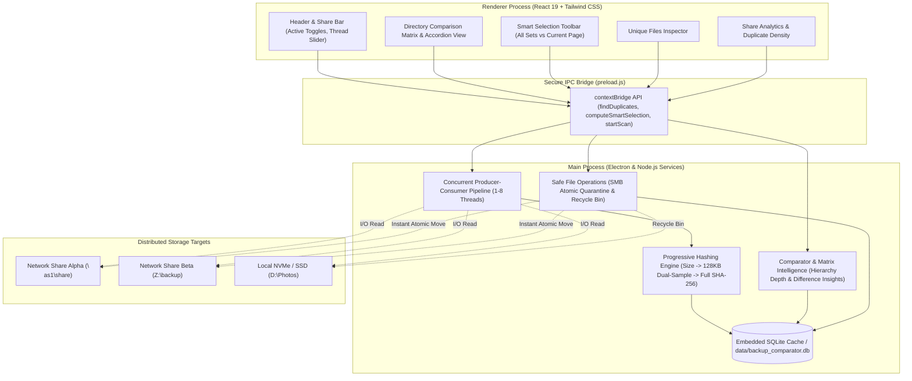
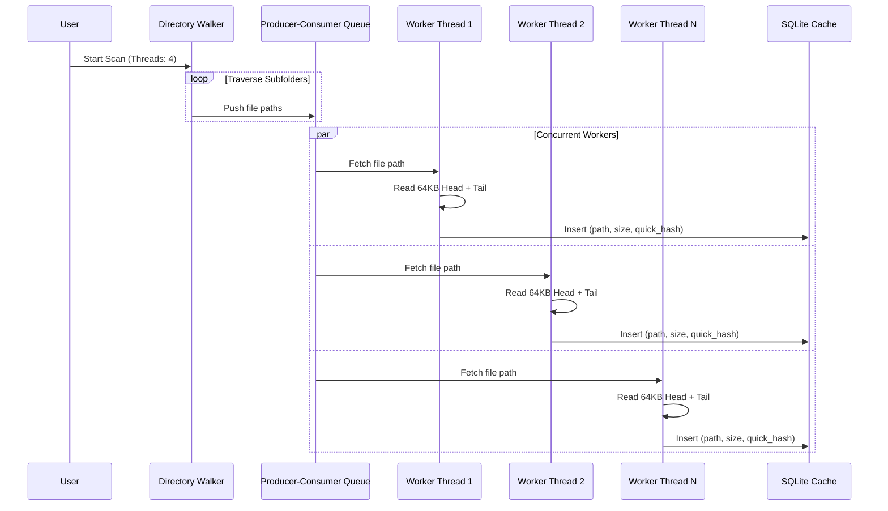
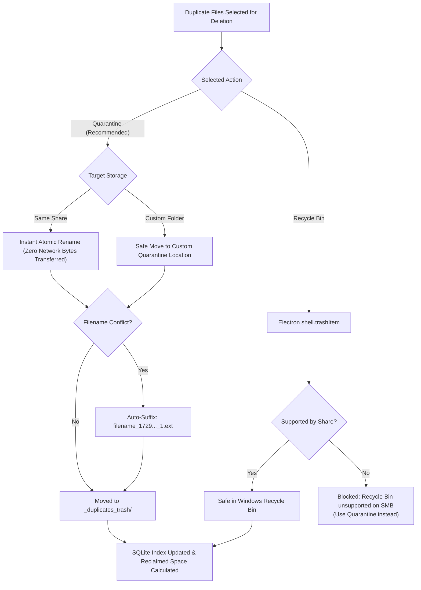

# ⚡ Multi-Share Duplicate Finder

<div align="center">


<br/>

**A high-performance desktop application designed to compare multiple network shares (SMB / UNC / NAS) and local directories simultaneously. Identify redundant data, inspect directory hierarchy depth, and safely reclaim gigabytes of storage across distributed systems.**

[Key Features](#-key-features) • [Architecture](#-architecture) • [Deep-Dive Functionality](#-deep-dive-functionality) • [Smart Selection Engine](#-smart-selection-rules) • [Safe Deletion & Quarantine](#-safe-deletion--network-quarantine) • [Getting Started](#-getting-started)

</div>

---

## 🧭 Why Multi-Share Duplicate Finder?

Traditional duplicate file finders assume a single local hard drive with direct SATA/NVMe access and often mandate rigid "Source vs. Destination" folder hierarchies. When managing multiple NAS units, backup servers, and shared network drives (e.g. `\\nas\photos`, `\\backup\archive`, `Z:\drive`, and local SSDs), this approach breaks down:

1. **Network Latency & Wire Saturation**: Calculating full file hashes over a 1 Gbps or 2.5 Gbps network pipe for terabytes of files takes hours and overloads the network.
2. **Missing Hierarchy Intelligence**: When identical files exist across drives, which copy is the keeper? Multi-Share Duplicate Finder calculates **Organization Depth Scores** to distinguish between files organized 3 levels deep in a structured archive vs. loose duplicates dumped in root directories.
3. **Destructive Network Deletion**: Windows Recycle Bin is frequently unsupported on network shares and SMB mounts. Accidental deletions over SMB are permanent without a dedicated, non-destructive **Quarantine Pipeline**.
4. **Scale Bottlenecks**: Deduplicating 50,000+ duplicate groups in a standard UI freezes the desktop. Our embedded SQLite engine evaluates selection rules across **all 50,000+ sets in under a second**.

---

## 🌟 Key Features

- 🌐 **True Multi-Directory Comparison**: Compare 2, 3, 5, or more network shares (`\\server\share\path`), mapped network drives (`Z:\`), and local folders concurrently with active toggle switches.
- ⚡ **Multi-Thread Producer-Consumer Pipeline**: Configurable 1 to 8 concurrent worker threads overlapping network I/O latency, directory traversal, and quick-hashing for a **~3.2x to 5x speedup**.
- 🚀 **Progressive Hashing Engine**: Triages files by exact byte size first, evaluates a 128 KB dual-sample hash (64 KB head + 64 KB tail SHA-256), and only calculates full hashes when strict disambiguation is required.
- 🔄 **Resumable & Incremental Scanning**: Interrupted or cancelled scans on multi-terabyte shares can be resumed instantly, skipping already indexed files.
- 🧩 **Directory Comparison Matrix**: Side-by-side breadcrumb visualization comparing organization depth, directory hierarchies, and file modification timestamps.
- 🎯 **Instant SQLite Batch Smart Selection**: Apply rules (Keep Deepest, Keep Newest/Oldest, Keep on Specific Share) across **all 50,000+ duplicate sets simultaneously** in milliseconds.
- 🛡️ **Keep Directory & Ignore Directory Workflows**:
  - **Keep Directory**: Protect an entire folder hierarchy and automatically mark all matching duplicate copies in other shares for deletion.
  - **Ignore Directory**: Hide whole directory subtrees from duplicate results without touching disk files.
- 📦 **Zero-Latency Network Share Quarantine**: Atomically renames duplicates into a designated share-local quarantine directory (`_duplicates_trash/`)—reclaiming active folder space instantly without moving heavy payload bytes across the network.
- 💎 **Unique Files Inspector**: View files that exist *only* on a specific share, safeguarding single-copy assets before running batch cleanup operations.
- 📊 **Share Health & Storage Density Analytics**: Visual progress bars displaying duplicate density percentages, total scanned capacity, and unique data per share.
- 🏷️ **Sidecar & System Extension Exclusions**: Out-of-the-box support for sidecar metadata (`.xmp`, `.thm`, `.aae`, `.dop`, `.pp3`) and system cache files (`Thumbs.db`, `.DS_Store`). Adding exclusions immediately cleans the duplicate cache in real time.

---

## 🏗️ Architecture

Multi-Share Duplicate Finder is built on **Electron**, **React 19**, **Tailwind CSS**, and **SQLite (sql.js)**. Network operations run asynchronously in background workers, communicating with the renderer through a secure `contextBridge` IPC layer.



---

## 🔍 Deep-Dive Functionality

### 1. Concurrent Network Scan Engine (1–8 Threads)
Network I/O over SMB and CIFS suffers from request round-trip latency. Multi-Share Duplicate Finder employs a **bounded producer-consumer queue**:
- A directory walker queues file paths.
- Configurable worker threads (default: **4 threads**, slider adjustable from **1 to 8**) pull from the queue, read file metadata, and compute sample hashes concurrently.
- Avoids blocking the main thread and accelerates scans on gigabit and multi-gigabit LAN connections.
- **Resumable Scan Support**: If a scan is stopped, the application stores indexed paths in SQLite. On restart, users can choose **"Continue / Resume Scan"** (skips existing files) or **"Fresh Rescan"**.



---

### 2. Progressive Hashing Algorithm
Rather than reading every gigabyte of data across a network share:
1. **Filter 1 — Byte Size Match**: Only files with identical file sizes are eligible as duplicate candidates.
2. **Filter 2 — 128 KB Dual-Sample SHA-256**:
   - For files $\le$ 128 KB: full hash is calculated.
   - For files $>$ 128 KB: reads the **first 64 KB** and the **last 64 KB**. This catches header metadata as well as tail container frames (common in videos, archives, and high-res RAW photos) in a single read cycle.
3. **Filter 3 — Full SHA-256 (On Demand)**: If multiple files share the exact size and dual-sample hash, a full hash disambiguation is triggered automatically.

---

### 3. Visual Directory Comparison Matrix

When inspecting duplicate sets, understanding *where* each file sits in your directory tree is critical:

| Component | Functionality |
| :--- | :--- |
| **Share Identity Badge** | Color-coded chip indicating the host drive or network share name. |
| **Directory Breadcrumbs** | Segmented, interactive folder path display highlighting every subfolder level. |
| **Organization Depth Score** | Computed metric: `Depth 0 (Root)`, `Depth 1 (Shallow)`, `Depth 3 (Organized Archive)`. |
| **Smart Difference Insights** | Automatic diagnostic summary banner: <br/>• *"1 copy in organized subfolder (3 levels deep), 2 loose in root folder"*<br/>• *"Copies across 2 shares and 3 different folders"*<br/>• *"Identical folder path across 3 different shares"* |
| **1-Click "Keep This Copy"** | Instantly marks the chosen copy as safe and selects all other copies in that group for deletion. |

---

### 4. Smart Selection Rules

Cleaning 40,000+ duplicate groups file-by-file is impractical. The Smart Selection Engine allows applying deterministic rules across the entire dataset or current page:

```
[ Keep Deepest (Most Organized) ]  [ Keep Shallowest ]  [ Keep Newest ]  [ Keep Oldest ]
[ Keep on Share... ▼ ]            [ Invert Selection ]  [ Scope: All Sets / This Page ]
```

- **Keep Deepest (Most Organized)**: Retains the file located deepest in the folder hierarchy (e.g. `/2023/Family/Holidays/photo.jpg` is kept, while `/photo.jpg` loose in the root is selected for deletion). Ties broken by newest modification timestamp.
- **Keep Shallowest**: Retains the top-level copy and selects deeper copies.
- **Keep Newest / Keep Oldest**: Compares modification timestamps (`mtime`) and selects older or newer duplicates.
- **Keep in Share**: Preserves copies located on your primary master share (e.g., `Primary-NAS`) while selecting redundant copies on secondary or backup drives.
- **Keep Outside Share**: Cleans duplicate copies out of a specific staging drive while ensuring files remain intact on other shares.
- **Invert Selection**: Reverses the current selection state within groups that have active selections.
- **Safety Enforcement**: The algorithm strictly enforces that **at least one copy in every duplicate group is kept safe**. It is mathematically impossible for the engine to mark all copies of a file for deletion.

---

### 5. Directory Power Workflows

#### 📁 Keep Directory
Select any directory or ancestor folder in a duplicate's path to declare:
> *"Keep all files in this directory; automatically mark all duplicate copies residing in OTHER shares/folders for deletion."*
- **Modal Preview**: Displays the exact number of files kept safe, duplicates marked for deletion, total recoverable gigabytes, and affected duplicate groups before making changes.
- **Instant Deletion Prompt**: Option to immediately review and trash marked files in one continuous flow.

#### 🚫 Ignore Directory
- Exclude a directory or subdirectory tree (e.g., intentional backup mirrors, templates, or legacy snapshots) from duplicate comparison.
- Files remain indexed in SQLite but are hidden from duplicate sets, summary bars, and batch deletion routines.
- Ignored directories can be unignored at any time from the UI.

---

### 6. Safe Deletion & Network Quarantine

Standard deletion over network shares is hazardous because SMB shares usually bypass the Windows Recycle Bin. Multi-Share Duplicate Finder solves this with a **Two-Tier Safety System**:



1. **Quarantine Mode (Default & Recommended for Network Shares)**:
   - Moves files to a designated folder on that same share (default: `_duplicates_trash/` or custom folder).
   - **Zero-Latency Atomic Rename**: On SMB / local storage, `fs.rename` is an atomic file system operation. No multi-gigabyte payloads are transferred over the network cable.
   - **Collision-Safe**: If a file with the same name already exists in quarantine, the engine appends a microsecond timestamp suffix (`photo_1729694700000_1.jpg`), preventing data overwrite.
2. **Windows Recycle Bin Mode**:
   - Uses native Windows API (`shell.trashItem`) to send local files to the Windows Recycle Bin.
   - For network shares that reject Recycle Bin trashing, the app prevents accidental deletion unless explicit fallback permissions are granted.

---

### 7. Unique Files Inspector (Data Loss Prevention)

Before cleaning or reformatting a drive or network share, you must ensure you are not deleting unique files that exist **only** on that share.
- Select any registered share to inspect files with zero duplicate counterparts across your other drives.
- Filter by search keywords, file size, or extension.
- Open files or reveal them directly in Windows Explorer.

---

### 8. Share Health & Duplicate Density Analytics

The **Stats Tab** provides holistic storage metrics across all monitored locations:
- **Total Monitored Capacity & File Count**: Unified view across local and network volumes.
- **Redundant Capacity & Percentage**: Visual progress bars showing duplicate density (e.g. `42.8% duplicated`).
- **Unique vs. Duplicate Visual Bar**: Instant visual confirmation of storage efficiency per share.
- **1-Click Filter**: Jump directly from a share's analytics card to its duplicate sets.

---

### 9. Sidecar & File Extension Management

Photography and creative workflows generate sidecar metadata files (`.xmp`, `.thm`, `.aae`, `.dop`, `.pp3`) or operating system cache files (`Thumbs.db`, `.DS_Store`). 
- **Global Exclusion List**: Manage excluded extensions through an interactive modal or 1-click pill buttons in group rows.
- **Dynamic Database Pruning**: Modifying the exclusion list immediately removes matching entries from the duplicate index without requiring a full rescan.

---

## 🚀 Getting Started

### Prerequisites
- **Operating System**: Windows 10 / 11 (or Windows Server)
- **Node.js**: v20+ or v24+
- **Network Permissions**: Read/Write access to target SMB/UNC network shares or mapped drives.

### Installation

1. **Clone the repository**:
   ```powershell
   git clone https://github.com/pdoteter/Duplicate-Finder2.git
   cd Duplicate-Finder2
   ```

2. **Install dependencies**:
   ```powershell
   npm install
   ```

### Launching the Application

- **Production Build & Launch**:
  ```powershell
  npm run build
  npm start
  ```

- **Live Development Mode (Vite HMR + Electron)**:
  ```powershell
  npm run electron:dev
  ```

---

## 🧪 Testing & Verification

Multi-Share Duplicate Finder includes an end-to-end integration test suite verifying multi-share indexing, 4-thread scan acceleration, smart selection rules, and non-destructive quarantine:

```powershell
# Run the main multi-directory verification test
npm test

# Benchmark concurrent thread scan performance
npm run test:threads

# Test directory comparison matrix & organization depth scoring
npm run test:compare

# Test share filtering and SQLite batch smart selection
npm run test:filter
```

---

## 📂 Repository Structure

```
Duplicate-Finder2/
├── electron/
│   ├── main.js                              # Process lifecycle, window management & IPC endpoints
│   ├── preload.js                           # Secure contextBridge API for the React renderer
│   └── services/
│       ├── db.js                            # SQLite database engine (sql.js) & schema migrations
│       ├── scanner.js                       # Multi-threaded directory crawler & sample hashing
│       ├── comparator.js                    # Duplicate grouping, depth evaluation & batch selection
│       └── fileOps.js                       # Network quarantine, Recycle Bin & Explorer integration
├── src/
│   ├── App.jsx                              # State coordinator, modal orchestrator & view switching
│   ├── index.css                            # Tailwind CSS directives & global dark theme styles
│   ├── main.jsx                             # React 19 entry point
│   ├── components/
│   │   ├── Header.jsx                       # Share badges, active toggles, thread slider & tabs
│   │   ├── DuplicateSummaryBar.jsx          # Storage metrics (cross vs same-directory statistics)
│   │   ├── DuplicateGroupsList.jsx          # Accordion duplicate groups & smart selection toolbar
│   │   ├── UniqueFilesView.jsx              # Single-instance file inspector (data loss prevention)
│   │   ├── ShareStatsView.jsx               # Storage breakdown & duplicate density progress bars
│   │   ├── KeepDirectoryModal.jsx           # Hierarchy selector for directory-level preservation
│   │   ├── IgnoreDirectoryModal.jsx         # Subtree exclusion modal
│   │   ├── ScanModal.jsx                    # Live multi-threaded scan traversal progress modal
│   │   ├── ScanChoiceModal.jsx              # Resume incomplete scan vs Fresh rescan prompt
│   │   ├── DeleteConfirmModal.jsx           # Safe quarantine & batch deletion confirmation
│   │   └── ExcludedExtensionsModal.jsx      # Sidecar and system file extension manager
│   └── utils/
│       └── formatters.js                    # Byte sizes, timestamps & path formatting helpers
├── verify-multi-directory-duplicates.js     # Multi-share integration test
├── verify-thread-scan-enhancement.js        # 4-thread pipeline benchmark
├── verify-directory-comparison-feature.js   # Matrix and depth scoring test
├── verify-share-filter-and-selection.js     # SQLite batch smart selection test
├── package.json                             # Project dependencies & scripts
├── tailwind.config.js                       # Tailwind styling configuration
└── vite.config.js                           # Vite build configuration
```

---

## 💡 Tech Stack

| Layer | Technology |
| :--- | :--- |
| **Desktop Shell** | [Electron 34](https://www.electronjs.org/) |
| **UI Framework** | [React 19](https://react.dev/) |
| **Styling** | [Tailwind CSS 3.4](https://tailwindcss.com/) |
| **Iconography** | [Lucide React](https://lucide.dev/) |
| **Database** | [sql.js](https://sql.js.org/) (Embedded WebAssembly / SQLite 3) |
| **Build Tool** | [Vite 6](https://vitejs.dev/) |
| **Runtime** | Node.js (Windows native I/O & `crypto` SHA-256) |

---

## 📄 License

This project is open-source under the [MIT License](file:///d:/Projects/Duplicate-Finder2/LICENSE). Feel free to use, modify, and distribute it for personal and commercial file deduplication.
